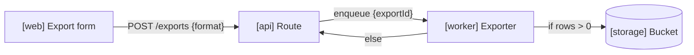

# Diagrams

A diagram earns its place when the reader would otherwise hold a structure in
their head while reading prose: who calls whom, which state follows which,
what sits inside what. Draw one without being asked when explaining any of
these:

- Architecture and the data flow between parts
- A request lifecycle or a multi-step process
- A state machine
- A directory or ownership tree
- A relationship model with cardinality

Do not diagram a simple list, a single function, a config example or an error
message. A list of three things is a list.

## Where it goes

The direct answer comes first, in one or two lines. The diagram comes right
after it and before the prose explanation. The reader sees the shape, then
reads the detail.

## Pick the format

| Format | Use when | Renders in |
|---|---|---|
| Unicode box-drawing in a code block | Chat replies, terminals, code comments, any markdown | Everywhere monospaced text shows |
| Mermaid | A README, PR, issue or wiki on GitHub, or a page published as an artifact | GitHub, many doc sites, claude.ai artifacts. A terminal shows the source |
| SVG | A diagram that ships as an asset: a README cover, docs site figure, slide | Browsers and image viewers. Use the `svg` skill |
| Markdown table | Comparing options on shared attributes | Everywhere. A "comparison diagram" is a table |

When unsure, use box-drawing. It degrades least.

## What every diagram carries

These rules hold in every format.

**Edges** carry:

- What flows along them: `{ invoiceId, amount }`, `job: Job`, `rows`.
- A condition on every branch: `if allowed`, `else`, `on retry`.
- The transport where it is not obvious: `HTTP POST`, `queue publish`,
  `SQL insert`.

**Nodes** carry:

- A role tag when roles mix: `[web]`, `[api]`, `[worker]`, `[db]`.
- For a state diagram, the data shape at that state: `File (uploaded,
  unparsed)`.

**Relationship diagrams** carry cardinality (`1:N`, `N:M`) and the foreign key
on each edge (`customer_id`).

**A one-line legend above** the diagram explains the role tags. Never write
captions that explain how to read the diagram ("each node shows..."). If it
needs instructions, fix the diagram.

Keep the aspect ratio balanced. The reader cannot resize the render, so a
diagram twelve boxes wide or forty rows tall needs splitting.

## Unicode box-drawing

- **78 characters wide at most,** so it fits an 80-column terminal.
- **Always inside a code block,** so it renders monospaced.
- No emoji, and no tab characters. Both break alignment.

Character palette:

```
Boxes:     ┌─┐ │ └─┘   ├ ┤ ┬ ┴ ┼
Arrows:    ──▶  ◀──  │ ▼  ▲ │
Dashed:    ╌╌╌▶  ┆        (optional or async)
Tree:      ├──  └──  │
```

Flow with labeled edges:

```
Role tags: [web] browser app, [api] HTTP server, [worker] job runner

┌─────────────┐  POST /exports   ┌─────────────┐
│ [web] Form  │ ────────────────▶│ [api] Route │
└─────────────┘  { format }      └──────┬──────┘
                                        │ enqueue { exportId }
                                        ▼
                                 ┌─────────────┐
                                 │ [worker]    │
                                 │ Exporter    │
                                 └─────────────┘
```

Sequence:

```
  Browser           API              Database
     │  GET /users   │                  │
     │──────────────▶│  SELECT users    │
     │               │─────────────────▶│
     │               │◀╌╌╌╌ rows ╌╌╌╌╌╌╌│
     │◀╌╌ 200 JSON ╌╌│                  │
```

Tree:

```
api/
├── routes/       one file per resource
│   └── exports.ts
├── jobs/         queue consumers
└── db/           migrations and queries
```

**Check alignment before handing over.** Box corners drift when a line is
one character off. With a code sandbox, run a short script over the diagram
that prints each line's width and flags any over 78. Read every column of
`│` from top to bottom and check it lines up. Wide characters (CJK, some
symbols) count as two columns and break the grid, so keep labels ASCII.

## Mermaid

Use the diagram type that matches the structure: `flowchart` for flows and
architecture, `sequenceDiagram` for calls over time, `stateDiagram-v2` for
state machines, `erDiagram` for relationships.



- Quote any label that holds brackets, braces or punctuation.
- Label every edge with the same payload and condition rules as above.
- Keep it under about fifteen nodes. Past that, split by subsystem.
- On GitHub, a fenced `mermaid` block renders in READMEs, PRs, issues and
  wikis. In claude.ai, publish it as an artifact to see it rendered.
- A Mermaid block that fails to parse shows as an error box. Render it once
  before handing it over: in an artifact, or with the Mermaid CLI if it
  installs in the sandbox.

## SVG

For a diagram that ships as a file (a docs figure, a README image), use
`svg`. It covers the viewBox, accessibility, and rendering the result to look
at it. The edge and node rules above still apply.

## Before handing over

- [ ] The direct answer comes first, the diagram second, the prose third.
- [ ] Every edge has its payload or condition. Every branch is labeled.
- [ ] Role tags have a one-line legend above.
- [ ] Box-drawing is in a code block and no line exceeds 78 characters.
- [ ] Mermaid or SVG was rendered and looked at.
- [ ] If the prose describing the flow changed, the diagram was re-read.
